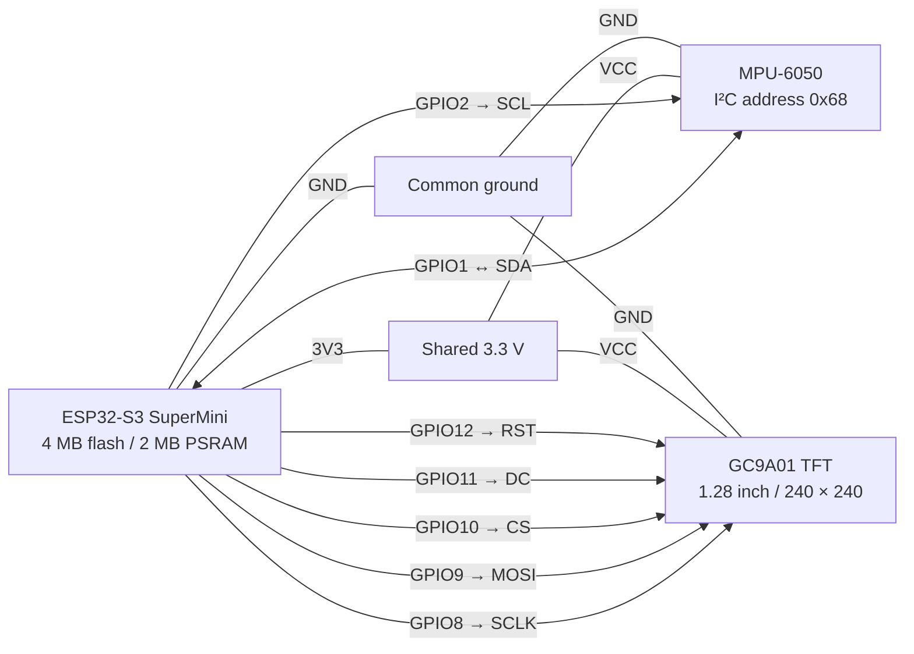

# ESP32-S3 attitude indicator — v1.0.0

PlatformIO/Arduino artificial horizon for an ESP32-S3 SuperMini and a 240×240
GC9A01 TFT. MPU-6050 address: `0x68`. Keep the sensor level during startup; the
first valid sample establishes zero. Serial command `z` re-zeros it later.

## Release status

**v1.0.0 accepted on 2026-10-30.** The project directory is now
`attitude-indicator/`, renamed from `digital-gauges/` for this release.
The version is recorded in `VERSION` and the firmware's serial startup banner.

This release provides the artificial horizon, bank indicator, serial re-zeroing,
sensor fault recovery, and watchdog recovery. Pitch/roll text, the frame counter,
and the display heartbeat are available through an optional debug overlay.
Hardware specifications, wiring, and operation are documented below.

Git repository: [joel-g/micro-electronics](https://github.com/joel-g/micro-electronics).
This project lives in `attitude-indicator/`.

Release checks completed: build/upload verification, geometry regression,
serial soak/reconnect, user-observed sensor disconnect/reconnect recovery, and
deliberate watchdog stall/recovery. The user accepted the extended stability
check after reporting continued operation; its exact duration and monitor state
were not recorded. Detailed measured results are retained below.

Known limits: approximately 12–13 fps measured with the debug overlay at the conservative 20 MHz SPI setting
(below the 15 fps target), a new zero reference on every MCU restart, and fixed
sensor axes. Compass, button selection, and CAN integration remain future work.

## Hardware

See the [bill of materials](docs/BOM.md) for quantities, module and chip
identifiers, and the manufacturer/supplier details still to be recorded.

| Component | Configuration / purpose |
| --- | --- |
| ESP32-S3 SuperMini | Microcontroller; 4 MB flash, 2 MB PSRAM; USB programming and serial diagnostics |
| MPU-6050 module | Accelerometer and gyroscope; I²C address `0x68`; pitch and roll input |
| GC9A01 round SPI TFT | 1.28-inch, 240×240 display; artificial horizon and numeric readouts |
| Interconnects | Signal wires plus shared 3.3 V and ground connections |

Firmware uses PlatformIO with the Arduino framework, `Wire` for the MPU-6050,
and Adafruit GC9A01A/GFX/BusIO for the display. I²C runs at 400 kHz and display
SPI currently runs at 20 MHz. No compass sensor, selection buttons, or CAN
interface are connected in this version.

Both modules share 3.3 V and ground. The uploader confirmed 4 MB embedded flash
and 2 MB embedded PSRAM. This firmware deliberately does not enable PSRAM:
the 115,200-byte framebuffer fits in fixed internal RAM. The generic DevKitC
board description still says 8 MB/no PSRAM; the project overrides flash size
to 4 MB and uses the 4 MB `default.csv` partition table (1.25 MiB app slots).

## Wiring diagram

This is a logical connection diagram, not the physical order of pins on the
modules. GPIO numbers refer to ESP32 GPIO names.



The table provides the same connections for terminal readers and Markdown
viewers without Mermaid support.

| ESP32-S3 pin | Connect to | Function |
| --- | --- | --- |
| GPIO1 | MPU-6050 SDA | I²C data |
| GPIO2 | MPU-6050 SCL | I²C clock |
| GPIO8 | GC9A01 SCLK | SPI clock |
| GPIO9 | GC9A01 MOSI | SPI display data |
| GPIO10 | GC9A01 CS | Display chip select |
| GPIO11 | GC9A01 DC | Display data/command select |
| GPIO12 | GC9A01 RST | Display reset |
| 3V3 | MPU-6050 VCC and GC9A01 VCC | Shared 3.3 V supply |
| GND | MPU-6050 GND and GC9A01 GND | Common ground |

The TFT data connection is SPI MOSI, separate from the MPU's I²C SDA signal.
No TFT MISO connection is used. The firmware does not configure an additional
backlight control pin; the diagram documents only the established wiring.

## CLI

Run from this directory. If `pio` is absent from PATH, use
`~/.platformio/penv/bin/pio`.

```sh
pio run
pio run -t upload --upload-port /dev/cu.usbmodem101
pio device monitor --port /dev/cu.usbmodem101 --baud 115200
```

Close other serial monitors before uploading or running the soak test.
Monitor DTR/RTS are configured low, but setting these lines while opening the
port caused a USB reset during the first test on this machine. The soak tool
avoids control-line ioctls entirely and clears POSIX HUPCL. Reset reason 11 means
USB reset on the installed Arduino core, not a watchdog timeout. A normal
PlatformIO monitor may still reset the board when it opens.

Single-character serial commands (newline optional):

- `d`: toggle labeled synthetic display motion. Real MPU sampling continues.
- `r`: hardware-reset/reinitialize only the TFT. Sensor zero is preserved.
- `z`: zero pitch and roll from a fresh sensor measurement.

## Reading the display

The normal v1 build hides the frame counter, bottom heartbeat dot, and numeric
pitch/roll readouts. Enable the compile-time `GAUGE_DEBUG_OVERLAY` flag to show
them. It defaults to `0` in the source; the `debug` and `watchdog-test` PlatformIO
environments set it to `1`. It does not control serial logging, the upper bank
indicator, `MPU FAULT`, or the `DEMO` label.

```sh
# Build/upload with the on-screen diagnostics enabled:
pio run -e debug -t upload
# Return to the normal display (debug overlay disabled):
pio run -e esp32-s3-devkitc-1 -t upload
```

Plain `pio run` and `pio run -t upload` select the normal environment. The debug
environment enables only the overlay; watchdog fault injection remains exclusive
to `watchdog-test`.

| Indicator | Meaning |
| --- | --- |
| Blinking yellow dot at the bottom (debug only) | Display heartbeat. Toggles on/off every half-second (one full blink per second), even when the sensor is stationary. Normal operation, not a warning. |
| Moving yellow dot on the upper bank scale | Bank-angle (roll) indicator. Moves with left/right tilt relative to the current zero reference. Centered at the top means zero relative roll. |
| Fixed white marks on the upper arc | Bank-angle references spaced 15° apart, from −60° to +60°. |
| Fixed yellow wings and center dot | The instrument's stationary reference symbol; the horizon moves around it. |
| `PITCH` / `ROLL` (debug only) | Angles in degrees relative to the current zero reference. |
| `FRAME` counter (debug only) | Advances with display updates, including when the sensor is stationary. |
| `MPU FAULT` | Sensor measurements are unavailable or stale; firmware retries the connection automatically. |
| `DEMO` | Synthetic display motion is enabled. The displayed attitude is simulated while real sensor sampling continues. |

With the debug overlay enabled, if the bottom heartbeat and frame counter stop changing, the display or firmware
may have stalled. A blinking heartbeat alone does not prove the sensor is healthy:
it continues on the fault screen too. The moving bank dot is a roll indicator,
not a compass heading or warning light.

## Startup zero and recalibration

On every boot, the **first valid MPU-6050 reading establishes zero pitch and
roll**, even if the sensor is tilted. Displayed 0° therefore means the startup
reference position, not necessarily level with the ground. The horizon and bank
indicator initially show that reference as level.

To use actual level as your reference, hold the sensor in its intended level
mounting position during startup. To change the reference without rebooting:

1. Place the sensor in the position you want to count as level and hold it still.
2. Open the serial monitor and wait for live readings to settle.
3. Send the single character `z`. Both pitch and roll are zeroed from the current
   filtered measurement. The command is ignored if sensor data is not fresh.

The zero is held in RAM, not saved across power cycles. Restarting the ESP32
(including a watchdog reset) establishes a new reference from its first valid
reading. Sensor reconnection and the `r` TFT-reset command preserve the existing
zero as long as the ESP32 itself does not reboot.

Zeroing sets angle offsets; it does not automatically compensate for arbitrary
sensor mounting, remap swapped axes, or calibrate gyroscope bias. Keep a consistent
mounting orientation so pitch and roll correspond to the intended vehicle axes.

## Freeze investigation and changes

The original freeze was not reproduced conclusively before modification. A
12-second baseline serial capture showed changing pitch/roll. Inspection of
the original source and the installed libraries found:

- **Framebuffer:** allocated once, 115,200 bytes, already checked for failure.
  No evidence of a per-frame leak or asynchronous buffer lifetime problem.
  It now uses fixed internal RAM, removing contiguous heap allocation as a
  dependency. Heap/minimum/largest-block/stack diagnostics remain available.
- **SPI:** Adafruit's mutable-buffer `drawRGBBitmap` already pairs
  `startWrite`/`endWrite`; a missing transaction end was not established.
  The library defaults to 40 MHz on ESP32. The firmware now selects 20 MHz
  explicitly and uses synchronous 8-row transactions. Each transaction releases
  SPI before servicing the sensor. This reduces sensitivity to wiring but does
  not prove that 40 MHz caused the freeze.
- **Serial blocking:** original per-frame `Serial.printf` runs in the same
  loop as sensing/rendering. The installed hardware USB CDC implementation
  can wait about 2 seconds under backpressure with its default timeout. That
  also exceeds the original filter's 200 ms integration cutoff. This is a
  credible freeze mechanism, not a confirmed root cause. Logging now runs once
  per second, uses a zero TX timeout and available-space check, and drops records
  instead of retrying or flushing.
- **Sensor failures:** failed reads originally returned silently, leaving old
  values on screen; startup failure stopped forever. Reads now have a 20 ms
  Wire transaction timeout. Five consecutive failures trigger reinitialization,
  with at most one attempt per second. Missing/stale samples show `MPU FAULT`.
  Recovery preserves the original zero and resynchronizes the filter after a
  long gap. The original ±2 g, ±250°/s ranges, axes, and low-pass setting remain.
- **Timing:** the first diagnostic build measured up to 34 ms just drawing the
  old per-pixel horizon. Ground spans are now calculated once per row. Target
  frame rate is 15 fps; sensor polling is scheduled at 10 ms intervals, including
  between SPI stripes. Actual rates are measurable, not hard real-time guarantees.
  Complementary-filter correction scales with elapsed time.
- **Hard hangs:** a five-second task watchdog resets a stuck loop. The retained
  operation stage and reset reason help identify a stall after reboot. The
  watchdog is fed only at loop completion. Reboot currently establishes a new
  sensor zero, so it is a recovery backstop rather than uninterrupted operation.

The TFT has no connected MISO/feedback path: a completed SPI call proves only
that the MCU sent data. It cannot confirm that the panel displayed it. Use visual
observation alongside serial logs; enable the debug overlay for the on-screen
frame counter and heartbeat.

## Reading diagnostics

Every second, `up`, `frame`, and `sample` report uptime in ms, completed frame
transfers, and successful MPU reads. They should keep increasing.

| Field | Meaning |
| --- | --- |
| `fresh`, `age` | Sensor validity and age in ms; age `4294967295` means no sample yet |
| `err`, `i2c` | Cumulative failed sample reads; last bus status (`254` short read, `253` wrong identity) |
| `retry` | Sensor initialization attempts, including startup |
| `drop` | Diagnostic records skipped/short-written because USB could not accept them |
| `over`, `sync` | Frames exceeding 67 ms; filter resynchronizations after long gaps |
| `max_us[...]` | Lifetime maximum sensor, drawing, single SPI stripe, full frame, loop, sample gap durations |
| `heap`, `min`, `largest`, `stack` | Free/minimum heap, largest internal 8-bit heap block, loop stack high-water free bytes |
| `reset`, `prev`, `wdt` | ESP reset reason, retained operation stage, watchdog enabled |
| `test` | `0` for normal firmware; `1` for the opt-in watchdog fault-injection build |

Stage numbers: 0 idle, 1 sensor, 2 drawing, 3 SPI, 4 logging, 5 sensor recovery,
6 TFT initialization, 7 intentional watchdog test. `prev=4294967295` means no valid retained stage. Only
interpret a retained stage as a stall clue with a matching panic/watchdog reset
reason; a USB/manual reset can interrupt any normal operation. Timings are
lifetime maxima, so manual TFT reset can legitimately raise loop/sample-gap maxima.

With the debug overlay enabled, if the frame counter advances while numbers stop, inspect sensor freshness and
errors. If serial counters advance but the physical TFT stops, try `d`, then
`r`, and inspect TFT wiring/power; try `TFT_SPI_HZ=10000000` as a controlled
comparison (frame rate will drop). If all progress stops, capture the reboot
reason/stage. Do not infer panel health from serial frame counts alone.

## Verification

Diagnostic captures and pre-release backups under `diagnostics/` are local
artifacts excluded from Git. The measured results below summarize those captures;
running the supplied hardware test tools creates new logs in a fresh checkout.

Host geometry regression compares the optimized ground spans against the original
per-pixel test across level, vertical, inverted, and off-screen horizons:

```sh
c++ -std=c++11 -O2 -I include test/horizon_geometry_test.cpp -o /tmp/gauge-geometry
/tmp/gauge-geometry
```

Hardware soak test (PlatformIO's Python includes pyserial):

```sh
~/.platformio/penv/bin/python tools/serial_soak.py
```

It checks normal logging, 60 seconds with an open but unread monitor, 20 seconds
with it closed, reconnect, demo mode, and TFT reinitialization. It verifies
continued frame/sensor progress, no resets or new I²C errors, sensor freshness,
and stable heap. An unread monitor does not necessarily saturate the OS buffers;
only an increase in `drop` demonstrates device-side log dropping. Use
`--backpressure-seconds 300` for a longer test. The log is saved under
`diagnostics/serial-soak.log`.

The user accepted the extended display stability check for v1 after reporting
continued operation. The sensor data-line disconnect/reconnect check also passed
by user observation, as recorded below; this does not establish recovery from
power loss or other electrical faults.

### Watchdog recovery test

The default PlatformIO environment remains `esp32-s3-devkitc-1`. Fault injection
is compiled only into the explicitly selected `watchdog-test` environment.
Its serial command `w` deliberately stalls the main loop without feeding the
watchdog, while interrupts and other tasks continue running. It does not call a
software reset. The normal build ignores `w`.

Keep the sensor in its intended level position: the watchdog reboot establishes
a new zero. Run from this project directory with other serial monitors closed:

```sh
pio run -e watchdog-test -t upload
~/.platformio/penv/bin/python tools/watchdog_test.py inject
# Restore normal firmware even if the injection test fails:
pio run -e esp32-s3-devkitc-1 -t upload
~/.platformio/penv/bin/python tools/watchdog_test.py production
```

The test checks watchdog enablement before issuing the stall command. Passing
requires task-watchdog reset reason `6`, retained stage `7`, restarted uptime,
and resumed frame/sensor counters with fresh measurements and no new I²C errors.
The production check confirms `test=0` and that `w` no longer stalls the loop.
Both tools leave serial control lines alone; neither requests a host reset.
Logs are saved to `diagnostics/watchdog-inject.log` and
`diagnostics/watchdog-production.log`.

### Results on 2026-10-30

- Normal v1 firmware with `GAUGE_DEBUG_OVERLAY=0` was successfully flashed after
  reconnecting USB; esptool verified the written data. The follow-up production
  check passed: frame/sensor counters advanced, measurements stayed fresh, no
  I²C errors or resets occurred during the check, and fault injection remained
  disabled (`test=0`). See `diagnostics/v1.0.0-overlay-off-production.log`.
  Both normal and debug builds passed; binary checks confirmed the numeric
  readout/frame labels are present only in the debug build while fault/demo
  labels remain in both. The earlier USB no-data failure is recorded separately
  in `diagnostics/v1.0.0-production.log`.
- Extended stability accepted by the user after continued operation, completing
  the v1 release checks. No precise duration or additional serial capture was
  supplied for this observation.
- Watchdog fault injection passed: a deliberate main-loop stall triggered the
  task watchdog, with the first healthy post-reset report received 6.21 seconds
  after the command. Diagnostics reported `reset=6`, `prev=7`, `wdt=1`, and fresh
  sensor readings. Frame and sample counters advanced for a further 12 seconds
  with no new I²C errors or repeated resets. This verifies the yielding-loop
  stall scenario; it does not simulate every possible hardware or interrupt fault.
- Normal firmware was rebuilt and flashed after the watchdog test. The follow-up
  check confirmed `test=0`, that `w` is ignored, and continued frame/sensor updates
  for 12 seconds without reset or I²C error. The fault-injection message is absent
  from the normal firmware binary and present only in the test binary.
- User confirmed the MPU-6050 SDA disconnect/reconnect check: the display showed
  `MPU FAULT` while disconnected and resumed working after reconnection. Recovery
  was observed visually; exact timing and serial diagnostics were not captured
  for this manual check.
- PlatformIO build and upload passed; flash contents verified by esptool.
  Static RAM: 139,264 / 327,680 bytes. Application: 400,434 / 1,310,720 bytes.
- Geometry regression passed 285,753,600 pixel classifications.
- Final soak passed: 12.56 fps and 87.95 successful samples/s across a measured
  104.3-second interval including paused reads, closed-port operation, reconnect,
  demo on/off, and TFT reinitialization. No MCU resets or I²C read failures.
- Free heap remained 227,936 bytes. Fifteen log records were dropped while
  disconnected without interrupting frame/sensor progress.
- Maximum normal drawing time was 18.134 ms, SPI stripe 2.144 ms, full frame
  81.302 ms, I²C read 0.819 ms, and sample gap 18.897 ms. The 15 fps target is
  not met at this conservative SPI setting; `over` correctly records this.
- Manual TFT reinitialization produced a deliberate ~0.76-second sampling gap,
  followed by one filter resynchronization. This is a diagnostic command, not
  part of routine operation.
- User confirmed responsive horizon motion and an advancing frame counter on
  the first diagnostic build. The final rendering optimization passed the
  geometry regression; final hardware logs are in `diagnostics/serial-soak.log`.
- The initial soak failed because opening the test port toggled RTS/DTR and
  reset the MCU (`reset=11`). That evidence is preserved in
  `diagnostics/serial-soak-initial-usb-reset.log`; the passive-port rerun passed.

API references: [Espressif Wire timeout API](https://docs.espressif.com/projects/arduino-esp32/en/latest/api/i2c.html)
and [Adafruit SPITFT transaction/pixel API](https://adafruit.github.io/Adafruit-GFX-Library/html/class_adafruit___s_p_i_t_f_t.html).
Implementation decisions were checked against the installed library sources,
not just current online documentation.

On the original development machine, source/config and the pre-change application
binary are backed up in the untracked `diagnostics/` directory. These backups are
not included in a clone. Where available, restore the two source/config backups
and rebuild/upload to roll back. The saved binary is an application image, not a
full-flash backup.

Future compass, button selection, and CAN tasks should use bounded service calls
and keep the diagnostics. The MPU-6050 has no magnetometer, so a compass needs
an additional heading source.
