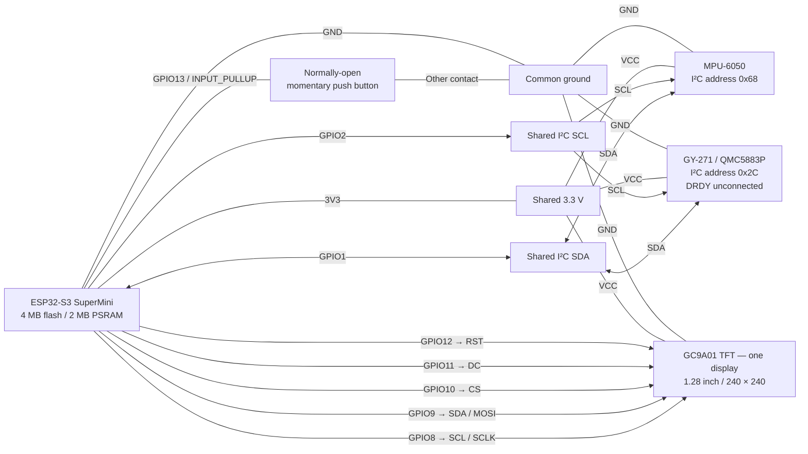

# Compass & Horizon — v1.1.0

Two instruments on **one** GC9A01 display, selected with a
GPIO13 push button. The project directory is `compass-horizon` (the chosen name
replaces the initially proposed `multi-gauge`).

This project reuses the released [compass](../compass/README.md) and
[attitude indicator](../attitude-indicator/README.md) implementations. Those
projects are preserved independently. No CAN, GPS, second display, or additional
sensor is implemented.

[Bill of materials](docs/BOM.md) · [Wiring diagram](#wiring-diagram) ·
[Build and upload](#build-upload-and-diagnostics) · [Verification record](docs/verification.md)

## Release status

**v1.1.0 was authorized for release on 2026-10-30.** It adds two-second
button re-centering in Horizon and light/dark theme toggling in Compass.
Short presses now switch instruments on release; releasing a long press never
switches instruments. Theme and attitude zero offsets are kept in RAM only.
The user confirmed both long-press actions and theme retention across mode changes.

`VERSION` and the firmware startup banner identify this release. The outstanding
combined-hardware checks accepted for v1.0.0 remain documented below.

The v1.0.0 core acceptance checks passed: both instrument faces respond, GPIO13 toggles
once per press/hold, thirty automated switches preserve sensor operation, and
saved mode selection survives a software restart. Compass calibration remains
intact, and magnetometer disconnection leaves the horizon operating.

Complete MPU-fault isolation and fault-screen appearance remain unverified.
Cold power-cycle mode persistence, an extended soak, and intentional watchdog
injection have not been tested in this combined application. Earlier standalone
project results do not substitute for these checks. See the
[verification record](docs/verification.md) for measured evidence and limitations.

## Hardware and wiring

The dedicated [bill of materials](docs/BOM.md) lists quantities, known module/chip
identifiers, compatibility requirements, and unrecorded purchasing details.

| Qty | Part / module identifier | Purpose |
| --- | --- | --- |
| 1 | ESP32-S3 SuperMini, 4 MB flash / 2 MB PSRAM | Controller; PSRAM is not enabled by this firmware |
| 1 | 1.28-inch 240 × 240 GC9A01 SPI TFT | Shared display for both faces |
| 1 | GY-271 with QMC5883P | Magnetometer, `0x2C`, chip ID `0x80` |
| 1 | MPU-6050 breakout | Accelerometer/gyroscope, `0x68` |
| 1 | Normally-open momentary push button | Mode selection; exact manufacturer/part number not recorded |
| 1 set | Interconnects and USB data/power cable | Prototype wiring and programming |

Exact module manufacturers, revisions, and supplier links remain unrecorded.
See the source projects' [compass BOM](../compass/docs/BOM.md) and
[attitude BOM](../attitude-indicator/docs/BOM.md) for known identifiers. GY-271
is a module designation: a QMC5883L/HMC5883L variant is not interchangeable with
this QMC5883P driver.

| ESP32-S3 | Connect to |
| --- | --- |
| GPIO8 | Display SCL / SCLK (SPI clock) |
| GPIO9 | Display SDA / MOSI (SPI data) |
| GPIO10 | Display CS |
| GPIO11 | Display DC |
| GPIO12 | Display RST |
| GPIO1 | MPU-6050 SDA and QMC5883P SDA |
| GPIO2 | MPU-6050 SCL and QMC5883P SCL |
| GPIO13 | One button contact |
| GND | Other button contact, display GND, both sensor GNDs |
| 3V3 | Display VCC and both sensor VCCs |

QMC5883P DRDY is unconnected. The display's SDA/SCL labels denote **SPI**;
the sensors use the separate shared I²C bus. GPIO numbers are not header positions.

### Wiring diagram

This is a logical connection diagram, not the physical order of module pins.
The connection table above also works in viewers without Mermaid support.



GPIO13 uses the internal pull-up; no external resistor is needed. The button
connects GPIO13 to ground when pressed (LOW) and is HIGH when released.

## Operation

- First use defaults to **Compass**. Later boots restore the last saved mode.
- **Short press (under 2 seconds):** toggle **Compass ↔ Horizon** on release,
  after debounce. The face does not switch when the button first goes down.
- **Hold for 2 seconds in Horizon:** set the current filtered pitch/roll as the
  displayed zero. A brief `LEVEL SET` banner confirms success. Release does not
  switch faces, and continuing to hold does not repeat the action.
- **Hold for 2 seconds in Compass:** toggle light/dark theme once. Release does
  not switch faces or toggle again. Light mode uses a white background, black
  heading/cardinal text and ticks, a red north mark, and a dark amber indicator.
- GPIO13 is `INPUT_PULLUP`: released HIGH, pressed LOW. Both edges use 40 ms
  debounce. Release it for at least 40 ms before another press. Hold timing and
  the 1.5-second confirmation use nonblocking elapsed-time checks.
- A button held during startup must be released before a press can be registered.
- Mode storage is automatic after 500 ms without another switch. Allow about a
  second before removing power. Serial `MODE save=1` confirms storage. Mode uses
  its own NVS namespace `compass-horizon`, separate from magnetic calibration.
- Both sensors continue updating in either mode. Switching does not re-zero the
  horizon, restart filtering, recalibrate the compass, or reinitialize hardware.

### Compass

The rotating rose, cardinal letters, fixed gold top marker, numeric heading,
wraparound, smoothing, and calibration indicators are reused from the standalone
compass. It uses **magnetic north**, assumes the sensor is level, and has **no
tilt compensation** even though an MPU is now active. Sensor +X is forward and
+Y is right; startup orientation is not automatically zeroed to north.

Hold the button for two seconds to toggle the compass's dark/light theme. The
choice is kept while switching faces during the current session; startup defaults
to dark. Theme is not stored in flash. Calibration and fault screens use the
selected theme too. Horizon retains its blue/brown face in either case.

Previously saved compass calibration is loaded from the same `qmc5883p` NVS
namespace and `hardiron` record format. A regular upload using the same partition
layout preserves it. Erasing flash removes saved calibration and mode settings.
Saving/erasing compass calibration here also changes what the standalone compass
loads when flashed back onto this same ESP32.

To recalibrate, select Compass and close any other serial monitor. Run from
the `compass-horizon` directory, using the port shown by `pio device list`:

```sh
python tools/serial_capture.py --port YOUR_PORT --send c --seconds 65
```

During the 60-second countdown, slowly rotate flat through a full circle, then
end-over-end and sideways through full circles. Point every face up and down
without straining wires. Keep away from metal/magnets. Return the sensor level.
`CAL INCOMPLETE` means repeat with more motion; previous offsets are retained.
After success, **`CAL RAM` is temporary**. Save before disconnecting power:

```sh
python tools/serial_capture.py --port YOUR_PORT --send s --seconds 5
```

Confirm `SAVE ok=1` / `CAL SAVED`. Reboot without saving restores the older stored
calibration, if any. Calibration corrects hard-iron offsets only. Changing faces
does not cancel calibration; it continues sampling in the background.

### Artificial horizon

The blue/brown horizon, white pitch ladder and bank marks, yellow fixed aircraft
symbol, and moving bank dot are reused from the attitude indicator.

Hold the MPU level during **power-up**, even when booting into Compass. Its first
valid sample establishes pitch/roll zero. Entering Horizon later preserves that
reference. To re-center without restarting, select Horizon, hold the instrument
in the position you want to display as level, and hold the button for two seconds.
The horizon immediately uses zero pitch/roll and briefly shows **LEVEL SET**.
Serial command `z` performs the same adjustment and confirmation in Horizon.

This is a **display-relative zero adjustment**, not physical sensor calibration.
For example, on a 10° incline, setting the reference makes that incline read as
level; moving away from it displays angles relative to the new reference.
It snapshots the existing filtered pitch/roll without resetting the MPU or its
filter. Sampling and smoothing continue. Zeroing is rejected if MPU data is
stale, and `LEVEL SET` is shown only on success.

The reference stays in RAM and survives face switching and sensor reconnection,
but is not saved to flash. An ESP32 restart establishes a new zero from its first
valid attitude reading, as before. It is independent of the compass's saved
magnetic calibration and the stored last-used face.

The existing ±2 g / ±250°/s ranges, low-pass setting, axis mapping, and
time-dependent complementary filter are preserved. Filter recovery after a long
gap preserves the original zero. Numeric pitch/roll, frame count, and heartbeat
are hidden by default; the `debug` build enables them on the horizon face.

## Build, upload, and diagnostics

From the repository root:

```sh
cd compass-horizon
pio run
pio run -t upload --upload-port YOUR_PORT
python tools/serial_capture.py --port YOUR_PORT --seconds 30
```

Replace `YOUR_PORT` with the ESP32 port shown by `pio device list`. Serial runs at
115200 baud. See the [repository setup guide](../README.md#build-and-upload)
for PlatformIO and Python setup. The capture helper avoids
DTR/RTS resets on macOS/Linux. Buffered older diagnostics can appear first when
reconnecting; check uptime. Close other serial readers before upload/capture.

```sh
# Optional horizon debug overlay:
pio run -e debug -t upload --upload-port YOUR_PORT
# Restore the default build:
pio run -e esp32-s3-devkitc-1 -t upload --upload-port YOUR_PORT
```

| Serial command | Action |
| --- | --- |
| `m` | Toggle face (same switch path as the physical button) |
| `z` | Zero the MPU from its current fresh measurement |
| `c` / `f` / `x` | Start 60-second compass calibration / finish early / cancel |
| `s` / `l` / `e` | Save / load / erase compass calibration |
| `i` | Repeat the incremental I²C scan |
| `r` | Restart ESP32 (unlike the standalone horizon's TFT-only `r`) |
| `?` | Print help |

One `INSTRUMENT` line per second reports current mode, raw button level, physical
press, long-press (`longs`), successful re-center (`levels`), and total switch
counts, mode save state, both sensors' sample/error/retry
counts, pitch/roll, heading/XYZ, calibration, heap, timing maxima, and watchdog
state. `max_us` is MPU service, magnetometer read, drawing, SPI batch, and loop.
`gap_us` is the maximum MPU sample gap. A growing `drop` count without a serial
reader is expected: logging drops records instead of blocking the gauges.

`prev` records the prior operation: idle 0, input 1, MPU 2, magnetometer 3,
drawing 4, transfer 5, logging 6, storage 7, scan 8. Interpret it with `reset`;
a manual reset can interrupt any stage. `wdt=1` means the 5-second loop watchdog
is registered. This project does not enable an intentional stall command.

`BUTTON long` reports a recognized hold. `LEVEL source=button ok=1` records a
successful button re-center, the immediately zeroed angles, and MPU initialization
count. A Compass hold increments `longs` and `themes` but does not change `levels`
or `switches`. `THEME compass=light/dark` reports a theme change, and `theme` in
periodic diagnostics always describes the Compass theme, including while Horizon
is selected.

## Architecture and fault handling

```text
src/main.cpp                 scheduling, mode selection/storage, diagnostics
src/input/Button.cpp         debounced input state machine
src/sensors/IMU.cpp           reused MPU reads/filter; nonblocking wake-up
src/sensors/Magnetometer.cpp  reused heading, calibration, freshness/retry logic
src/sensors/qmc5883p.cpp      unchanged QMC5883P register driver
src/sensors/calibration_store.cpp  unchanged saved-calibration format
src/gauges/CompassGauge.cpp   reused compass artwork
src/gauges/AttitudeGauge.cpp  reused horizon artwork and row-span geometry
src/gauges/Display.cpp        shared canvas, palette, and bounded SPI transfers
```

I²C and the display initialize once at startup. Device recovery only configures
the affected sensor: it never tears down the shared bus or runs on a mode switch.
MPU wake-up keeps its 100 ms settling interval as a nonblocking state. Missing
devices retry at most once per second, with 20 ms I²C transaction timeouts.

The selected face shows `MAG FAULT` or `MPU FAULT` for unavailable/stale data.
A missing sensor does not prevent switching to or sampling the other instrument.
A physical short or device holding the **shared** bus low can affect both sensors;
software cannot electrically isolate that fault. The button still selects faces.

The display uses the proven 20 MHz SPI configuration. Two static indexed buffers
total 115,200 bytes, plus a 256-byte transfer tile. Both faces use one fixed palette
with the original colors. Only changed 16 × 8 tiles are sent, up to eight per
loop; each transaction completes before sensor/button processing resumes. Mode
switches replace the old face, including when a previous frame was partly sent.
No framebuffer allocation or display reset occurs during switching.

Drawing is scheduled up to 20 Hz for Compass and 15 Hz for Horizon, subject to
transfer time. An unchanged screen sends no tiles, so a stationary frame counter
alone is not evidence of a freeze. Serial logs verify MCU progress; visual checks
are still needed to confirm the physical display.

## Verification

See [verification notes](docs/verification.md) for test results and limitations.
Native tests use the copied compass math and horizon geometry tests plus new
button bounce, short-on-release, 1999/2000 ms boundary, long-release suppression,
startup-held, timer-rollover, and mode-action checks:

```sh
c++ -std=c++17 -O2 -I include test/button_test.cpp src/input/Button.cpp -o /tmp/ch-button && /tmp/ch-button
c++ -std=c++17 -O2 -I include test/compass_math_test.cpp -o /tmp/ch-compass && /tmp/ch-compass
c++ -std=c++17 -O2 -I include test/horizon_geometry_test.cpp -o /tmp/ch-horizon && /tmp/ch-horizon
```

The hardware switch test sends 20 regular and 10 rapid mode switches, checks
continued sensor progress without reinitialization or new errors, saves Horizon,
restarts to verify mode persistence, and returns to Compass. Keep the button
released and MPU level while it runs; it leaves magnetic calibration unchanged.

```sh
python tools/switch_test.py --port YOUR_PORT
```

Physical acceptance: rotate the level magnetometer in Compass, press once and
tilt the MPU in Horizon, then short-press again to return. In Horizon, hold the
tilted MPU still and press for two seconds: confirm a level display and `LEVEL SET`,
with no face switch on release. Hold in Compass: confirm a white face, then hold
again to return to dark; release must not switch faces. Repeat short presses
afterward and verify the theme survives a visit to Horizon. Reboot after a saved Horizon selection
to confirm mode persistence and the normal startup zero. Separate
sensor-disconnection checks can confirm the unaffected face remains available.
