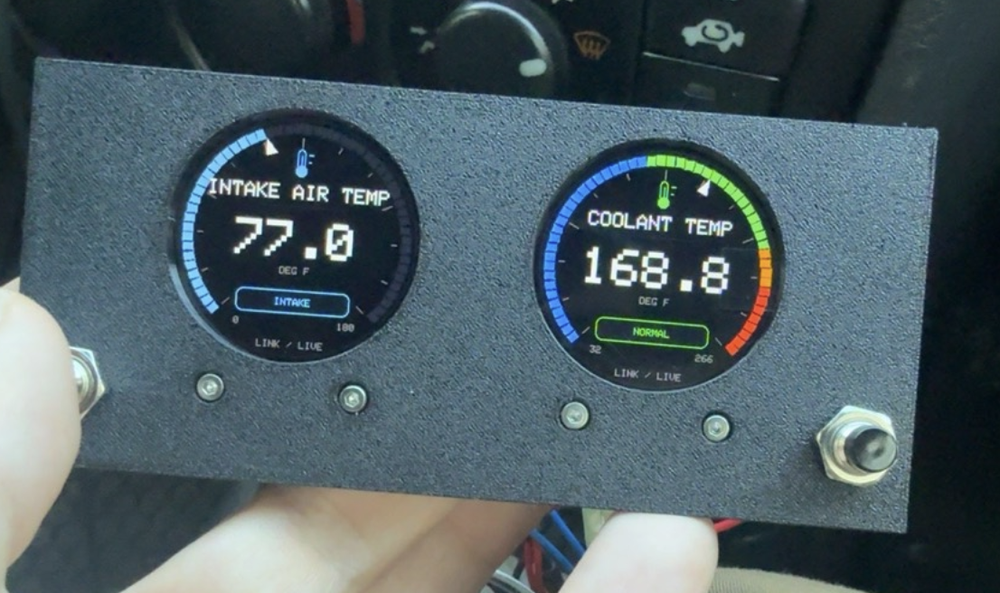
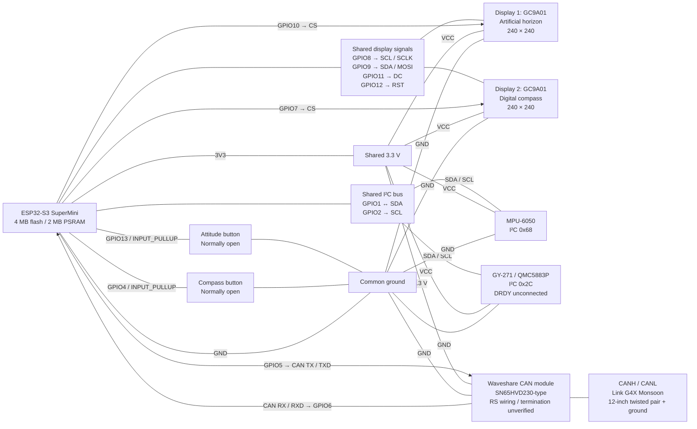
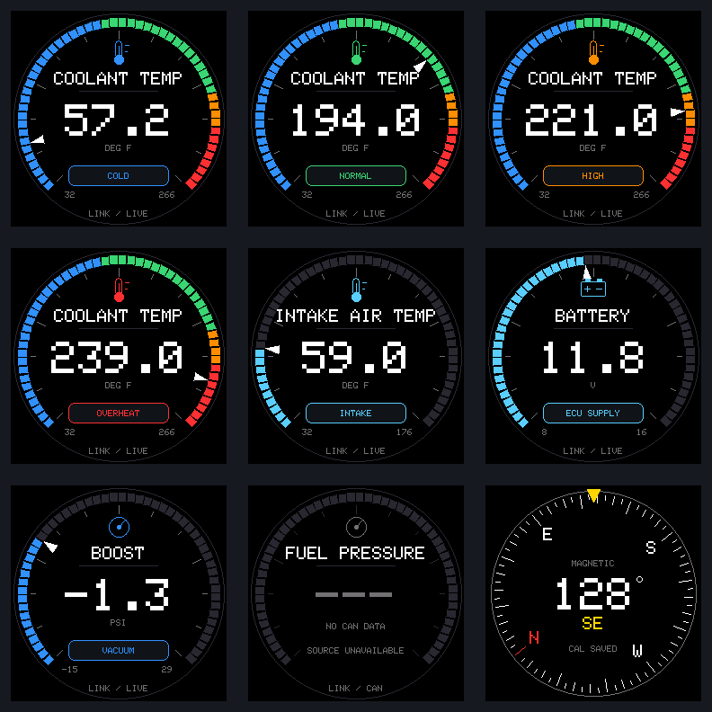

# Dual Gauge CAN v1.0.0



*Vehicle-tested graphics with live Link CAN data: intake air temperature on the
left and coolant temperature on the right. Photo taken before the final JSON
configuration update.*

Dual-display firmware based on [Dual Gauge with Buttons](../dual-gauge-with-buttons/README.md).
It adds configurable engine gauges using Link Generic Dash CAN. The documented
vehicle setup is a 2001 Honda CR-V with a Link **G4X Monsoon (MonsoonX),
firmware 6.22.3** ECU.

- [Bill of materials](docs/BOM.md), [wiring diagram](#wiring-diagram), and
  [enclosure and print guide](../dual-gauge/enclosure/README.md)
- [Instrument configuration](docs/configuration.md),
  [Link Generic Dash decoder and test plan](docs/link-generic-dash.md), and
  [vehicle connection notes](docs/vehicle-connection.md)
- [Verification record](docs/verification.md) and [v1.0.0 release notes](docs/release-v1.0.0.md)

**v1.0.0 is published with known validation limits.** The JSON configuration
revision has passed automated checks and builds but has not yet been flashed
or hardware-tested. The preceding graphics/CAN revision was tested in the
vehicle.

In the vehicle test, the module connected directly to the Link in place of the
AEM lambda through a 12-inch twisted pair and ground. The first listen-only
capture received repeated ID 0 traffic at 500 kbit/s. A later acknowledging
build received the 14-frame Generic Dash stream at about 280 frames/s with no
reported receive losses in the capture. The test compared MAP/BAP with PCLink
and confirmed live coolant, battery, and IAT on the displays.

## Configure your instrument

Edit **[config/instrument.json](config/instrument.json)**, then build and flash.
No application-code changes are needed to select/order faces, match the Link
Generic Dash CAN settings, change units, choose compass/horizon presentation,
or adjust scales and coolant color thresholds.

```json
"displays": {
  "1": ["horizon", "coolant", "rpm", "boost"],
  "2": ["compass", "battery", "iat"]
}
```

These are the shipped button cycles. Remove faces for sensors you do not have;
add supported faces only when their ECU sources are installed and configured.
The build validates JSON and generates constants automatically. Configuration is
compiled into firmware, so changes require a rebuild/reflash. CAN settings must
also match PCLink; this file does not configure the ECU remotely.

See **[Configuration reference](docs/configuration.md)** for every setting,
available faces, optional sensor mappings, saved-selection behavior and examples.

## Wiring

ESP32-S3 SuperMini: 4 MB flash / 2 MB fitted PSRAM. PSRAM remains disabled.
Both TFTs are GC9A01, 240×240, 1.28 inch. All fitted modules share 3.3 V/GND.

| GPIO / pin | Connection |
| --- | --- |
| GPIO1 | MPU-6050 SDA and QMC5883P SDA |
| GPIO2 | MPU-6050 SCL and QMC5883P SCL |
| GPIO4 | Display 2 button → GND; INPUT_PULLUP |
| GPIO5 | CAN module TX / CTX / TXD (transceiver input) |
| GPIO6 | CAN module RX / CRX / RXD (transceiver output) |
| GPIO7 | Display 2 CS |
| GPIO8 | Both TFT SCL / SCLK, SPI clock |
| GPIO9 | Both TFT SDA / MOSI, SPI data |
| GPIO10 | Display 1 CS |
| GPIO11 | Both TFT DC |
| GPIO12 | Both TFT RST |
| GPIO13 | Display 1 button → GND; INPUT_PULLUP |
| 3V3 / GND | Both TFTs, MPU, magnetometer, CAN module |
| CANH / CANL | Direct Link CAN-H / CAN-L, 12-inch twisted pair; common ground |

MPU-6050 address: `0x68`; QMC5883P: `0x2C`, ID `0x80`; DRDY unconnected.
TFT SDA/SCL are SPI, separate from sensor I²C. Neither TFT uses MISO. GPIO7
remains Display 2 chip-select; GPIO4 is its button, not a chip-select.

### Wiring diagram

This Mermaid diagram shows logical connections. The table above remains usable
in Markdown viewers without Mermaid support.




## Independent buttons and gauge order

| Screen / button | Short press cycles in this order |
| --- | --- |
| Display 1 / GPIO13 | Horizon → Coolant → RPM → Boost → Horizon |
| Display 2 / GPIO4 | Compass → Battery → Intake air temperature → Compass |

Short presses act on release, with independent 40 ms debounce. Holding for two
seconds fires one long event, and release never cycles a gauge afterward. A
held-at-boot button must be released to arm it. Both buttons remain responsive
while the other is held. A GPIO13 long press re-centers **only when Horizon is
selected**, preserving the filter and showing LEVEL SET for 1.5 seconds. All
other long presses are unassigned, including Compass; calibration remains
available over serial.

First startup defaults to Horizon/Compass. Gauge selections save independently
after 300 ms under new `dual-can/display1` and `dual-can/display2` NVS keys, with
readback and five-second retry on write failure. Stable gauge IDs are saved,
so reordering a list does not reinterpret an existing selection. Invalid or
removed selections fall back to the first face in that screen’s manifest. Selection changes
never reinitialize a display, sensor, or CAN driver.

Compass theme and Standard/Numerical attitude presentation come from JSON
(defaults: dark and numerical). Older `dual-buttons` presentation settings are
ignored. Buttons do not cycle presentation styles. The original
settings and `qmc5883p/hardiron` calibration records are not overwritten by gauge
selection changes. Attitude zero remains RAM-only and initializes from the first
valid MPU sample after each restart; keep it still at startup.

## CAN bring-up and diagnostic limits

The built-in TWAI controller uses **TX5/RX6, Classic CAN**. The shipped JSON
selects `normal_rx`: default, debug and vehicle builds acknowledge valid frames
and can send controller error frames for the two-node connection. There are no
application messages. The `listen-only` environment uses the separate passive
example JSON; environment names do not override JSON settings. TX queue
length is zero, with no transmit API call, loopback, self-test traffic or automatic
mode change. Listen-only disables
messages, acknowledgements and error-frame transmission, as documented by
[Espressif](https://docs.espressif.com/projects/esp-idf/en/v5.5-beta1/esp32s3/api-reference/peripherals/twai.html).
It can observe a working bus but does not provide acknowledgements for a lone
transmitter in a two-node test.

`can.bitrate: 500000` matches the November 8 PCLink screenshot. Supported settings
are 125000, 250000, 500000 and 1000000. There is no automatic bitrate scan.
Invalid configuration fails the build; runtime CAN driver failures do not stop
the local sensors/screens.

Driver initialization/start results are logged. `CAN STATUS` appears once per
second with configured bitrate, running state, processed frame count/rate,
unique IDs tracked, last frame age (`-1` means never), alerts, driver errors,
receive queue/loss counters, bus errors, TEC/REC, and receiver service time.
A disconnected bus should report zero frames; it is an expected waiting state.
Initialization success is not proof of a working transceiver or actual reception.

Raw frame logging is limited to approximately five frames/s:

```text
CAN ID: 0x... FORMAT: STD/EXT RTR: 0 DLC: 8 DATA: ...
```

Standard, extended, and remote frame metadata are retained. Remote frames have
no printed payload. Up to 128 distinct IDs/formats are tracked; `j` prints this
list incrementally, plus latest Generic Dash subframe snapshots with counts
and ages. `id_overflow_frames` flags observations outside a full table,
so the displayed ID count is then a lower bound. `logged_skipped` includes sampled
out frames and serial backpressure, not lost driver reception. Actual queue/FIFO
loss is reported separately. This monitor is not a lossless high-load CAN recorder.

The driver has a 128-frame RX queue. Main-loop work polls without waiting and
processes at most 64 frames / approximately 750 microseconds per call, checking
the time budget between frames. All model updates, rendering, and CAN processing
use the same application task; the TWAI driver owns its receive queue. There is
no second task mutating the engine model, so no application locking is needed.
Unexpected bus-off stops/uninstalls the receiver and retries after five seconds,
in the explicitly selected build mode. Alert output is aggregated rather than logged from an ISR.

## Engine model and gauge faces

`engine_data.h` defines timestamped channels independent of CAN protocol. Each
records whether anything has ever arrived, its validity, and last-update time.
`EcuDecoder` is the extension interface; `LinkGenericDashDecoder` handles the
configured CAN ID/format with strict framing and documented little-endian
multiplexed fields. The shipped ID is standard 1000. RPM, coolant, IAT,
MAP/barometer and battery are implemented. Oil, fuel and lambda decoding is
opt-in through the face manifest; the shipped lists omit these absent/unconfirmed
sources. Fan status has no mapping and is rejected by configuration validation.
Other ECU decoders can fill the same model without changing widgets.

JSON controls each screen’s ordered list, stale timeout (default 1500 ms), units,
and Lambda/AFR choice. The widget shows a valid value and units or explicit
NO CAN DATA / WAITING FOR ECU, STALE, or INVALID DATA. Unknown values never
appear as zero. Stationary, unchanged faces skip pixel transfers.

Default units are °F and PSI. AFR is opt-in and uses the configured fuel
stoichiometric ratio. Boost requires fresh **absolute manifold pressure and
actual atmospheric pressure**, then subtracts atmospheric pressure before unit
conversion. No fixed atmospheric value is substituted. See the decoder document
for field mappings and verification limits.

## Gauge graphics and coolant colors

Engine faces use a black background, a segmented 270° scale, a white pointer,
a large numeric reading and a text status badge. Static faces skip redraws;
changed pixels still use the bounded tile-transfer path. A scale endpoint clamps
the pointer only: out-of-scale numeric values are never clipped to a false limit.

Coolant display thresholds in `config/instrument.json` (`display.coolant_c`) were approved for this
prototype; they do not change ECU controls or replace engine-specific limits:

| Coolant temperature | Color | Label |
| --- | --- | --- |
| Below 60°C / 140°F | Blue | COLD |
| 60°C to below 100°C / 140°F to below 212°F | Green | NORMAL |
| 100°C to below 110°C / 212°F to below 230°F | Orange | HIGH |
| 110°C / 230°F and above | Red | OVERHEAT |

IAT and battery use cyan. Negative boost uses blue and VACUUM; positive boost
uses cyan. Other face accents/scales are descriptive, with no unapproved engine
warning thresholds. Missing, stale or invalid readings remove the live pointer
and colored scale and show explicit status text. Fuel, oil and lambda are omitted from the shipped manifest; adding them enables
the corresponding defined CAN fields. Fan status is not supported yet.

Example faces rendered by the same Adafruit GFX library as the firmware (fixture
values, not a live dashboard):



Recreate the preview after a PlatformIO vehicle build with
`sh tools/render_gauges.sh`. This uses a small host adapter and the installed
pinned Adafruit rasterizer; no extra Python packages are required.

## Local sensors and calibration

Both sensors run regardless of selected gauge. The existing MPU complementary
filter, horizon geometry, QMC5883P driver, hard-iron validation and NVS record,
heading smoothing, and wraparound are reused. A missing sensor faults its local
face and retries without resetting the other device. A shared bus held low may
affect both devices; software cannot electrically isolate that fault.

Saved magnetic calibration loads at startup and survives a normal reflash with
the same partition layout. For manual recalibration, select Compass, send `c`,
then turn/tip/invert the magnetometer through all axes for 60 seconds. A valid
result displays CAL RAM; send `s` to retain it and confirm SAVE ok=1 / CAL SAVED.
`f` finishes a serial collection early after sufficient samples/motion and ten
seconds minimum; `x` cancels; `l` reloads; `e` erases. Invalid collection keeps
prior offsets. GPIO4 long press does not start calibration in this milestone.
Read heading with the magnetometer approximately level, away from changing metal
or magnetic fields. Heading is magnetic north, with no declination/tilt compensation.

## Build and bench test

From the repository root:

```sh
cd dual-gauge-can
pio run
pio run -e debug
pio run -e vehicle  # same JSON as default; shipped normal_rx acknowledges CAN
pio run -e vehicle -t upload --upload-port YOUR_PORT
# Optional passive build: pio run -e listen-only
pio device monitor --port YOUR_PORT --baud 115200
```

Replace `YOUR_PORT` with the ESP32 port shown by `pio device list`. See the
[repository setup guide](../README.md#build-and-upload) for PlatformIO and Python setup.
The project pins the framework and libraries and uses a 4 MB flash partition
layout, USB CDC, and 20 MHz SPI. Both CS lines
start HIGH; shared RST is pulsed once, then CS-scoped initialization preserves
the first panel. Each display owns its existing indexed canvas/shadow; transfers
remain synchronous, at most four changed tiles per screen per loop. Mode changes
replace only the affected pending face without allocating framebuffers.

```sh
python tools/serial_capture.py --port YOUR_PORT --seconds 300 --log diagnostics/bench.log
```

Serial `DUAL` diagnostics retain sensor freshness, errors, pitch/roll/heading,
per-panel progress, modes, heap and reset information. CAN has a separate summary
line to keep output bounded. `v` prints the configuration hash, declared ECU
settings and face counts. `?` lists commands; `i` scans I²C; `j` lists observed
CAN IDs and Generic Dash subframe snapshots; `r` restarts. `ENGINE` logs decoded
values and freshness independently of the selected face. There are no engine demo values or commands to transmit.
The inherited analyzer checks stable DUAL reports; inspect CAN summaries separately.

Bench acceptance with CANH/L disconnected: verify CAN initializes and reports
zero frames, cycle both screens independently through all configured faces, return to
Horizon/Compass and move both sensors, test the Horizon long press, and confirm
saved selections after restart. Repeat switching during a sustained capture and
check heap, sensor rates, read errors, CAN alerts, and resets. Only actual bus
frames can establish that CAN reception works. Future vehicle steps are in
[vehicle-connection.md](docs/vehicle-connection.md).

## Native verification

```sh
sh tools/run_native.sh
```

Run from `dual-gauge-can` on a host with Python 3 and a C++17 compiler.
Configuration tests validate malformed inputs and compile/run an alternate
metric/extended-ID configuration with optional sensors enabled. Eleven native
executables exercise the real model/conversions, mode storage, CAN
receiver with a fake transport, button state machines, display transfer logic,
compass math, horizon geometry and calibration workflow. Test fixtures stay in
host binaries; they are not fake measurements displayed by firmware. See the
verification record for the separate physical bench results and remaining work.

## License

Original code and technical documentation use the [MIT License](../LICENSE).
Commercial use, modification and redistribution are permitted under its terms.
The vehicle photograph is excluded; third-party dependencies retain their own
licenses. See [licensing scope](../LICENSING.md) for details.
