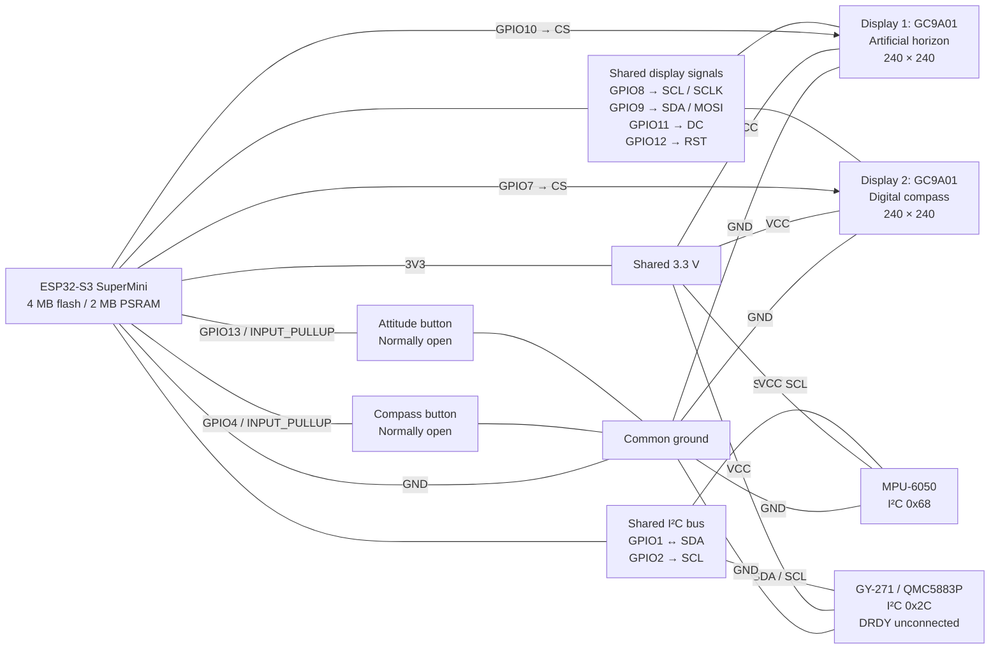

# Dual Gauge with Buttons — v1.0.0

Two continuously running GC9A01 instruments with independent controls:

- **Display 1, CS GPIO10:** artificial horizon; button on **GPIO13**.
- **Display 2, CS GPIO7:** magnetic compass; button on **GPIO4**.

This firmware was derived from the original dual-display prototype.

Both screens run continuously. Each button changes only its associated screen.
The connected CAN transceiver is ignored: GPIO5/6 are neither configured nor read,
and no CAN peripheral, decoding, ECU integration, or additional sensor is enabled.

Released on 2026-11-05 after physical button, calibration, and cold-start
persistence checks. Build results and remaining test limits are recorded below.

[Bill of materials](docs/BOM.md) · [Wiring diagram](#wiring-diagram) ·
[Verification record](docs/verification.md) · [Enclosure and print guide](../dual-gauge/enclosure/README.md)

## Wiring

ESP32-S3 SuperMini: 4 MB flash, 2 MB fitted PSRAM. PSRAM is disabled. Each TFT is
1.28-inch, 240×240, GC9A01 SPI. All modules share 3.3 V and ground.

| ESP32 pin | Connection |
| --- | --- |
| GPIO1 | MPU-6050 SDA and QMC5883P SDA |
| GPIO2 | MPU-6050 SCL and QMC5883P SCL |
| **GPIO4** | Compass button contact; other contact to GND |
| GPIO5 / GPIO6 | Fitted CAN TX / RX wiring; unused by firmware |
| **GPIO7** | Display 2 compass CS |
| GPIO8 | Both displays SCL / SCLK (SPI clock) |
| GPIO9 | Both displays SDA / MOSI (SPI data) |
| GPIO10 | Display 1 horizon CS |
| GPIO11 | Both displays DC |
| GPIO12 | Both displays RST |
| **GPIO13** | Attitude button contact; other contact to GND |
| 3V3 | Both display VCCs and both sensor VCCs |
| GND | Both display GNDs, both sensor GNDs, both button ground contacts |

Both buttons are normally-open momentary contacts, configured `INPUT_PULLUP`:
released HIGH, pressed LOW. No external pull-up resistors are required.
QMC5883P DRDY is unconnected. MPU-6050 address is `0x68`; QMC5883P is `0x2C`, ID
`0x80`. QMC5883L and HMC5883L have different register maps and are not substitutes.

The display SDA/SCL labels denote SPI, separate from sensor I²C. No display MISO
is used. GPIO numbers are not physical header positions. In particular, keep
Display 2 **CS on GPIO7** and **DC on GPIO11**; swapping these previously caused
its backlit panel to remain black.

### Wiring diagram

This Mermaid diagram shows logical connections. The table above remains usable
in Markdown viewers without Mermaid support.




## Button controls

| Button | Short press, released before 2 seconds | Hold for 2 seconds |
| --- | --- | --- |
| Compass, GPIO4 | Toggle Dark ↔ Light | Start a full 60-second calibration and auto-save valid results |
| Attitude, GPIO13 | Toggle Standard ↔ Numerical | Re-center the current filtered pitch and roll; show LEVEL SET |

Buttons have independent 40 ms debounce state machines. A short action occurs on
release; a long action fires once at two seconds. Holding longer does not repeat
it, and releasing a long press does not trigger a short action. A button held at
startup must be released before it is armed. Either button remains usable while
the other is held or while compass calibration is running.

First startup defaults to **Dark** and **Standard**. The selections are stored
independently under `dual-buttons/compass` and `dual-buttons/attitude` in NVS.
Changes are saved after 300 ms without another change to that selection, and
verified by readback; failed writes retry at five-second intervals. Wait for
`SETTINGS saved ... ok=1` before removing power. Fast toggles are coalesced to
avoid unnecessary flash writes. Mode changes do not reinitialize displays or sensors.

### Compass themes

Dark keeps the previous compass appearance. Light retains its layout with a
white background, black heading/cardinal text and markings, red north, and a
dark amber fixed heading indicator. Calibration and result screens use the
selected theme too. Changing theme during calibration changes only the colors;
the collection continues, then returns to the currently selected theme.

The compass shows magnetic north, N/E/S/W, 000–359° heading, and the existing
wraparound-aware smoothing. Keep the sensor approximately level for heading
readings. +X is forward and +Y is right. There is no declination or tilt compensation.

### Attitude presentation and level reference

Standard preserves the existing blue/brown horizon, pitch ladder, fixed aircraft
symbol, bank marks, and moving bank indicator, with no numerical angle readouts.
Numerical adds signed degree values (for example `P +12.4°`, `R -8.2°`) in two
panels below the central aircraft symbol. Both remain live during animation.

A two-second hold in either mode captures the **current filtered** pitch and roll
as display-relative zero. The next rendered face uses that reference immediately,
with `LEVEL SET` for 1.5 seconds. Sensor fusion continues without restarting the
MPU. If the MPU is stale, zeroing is refused and no success banner is displayed.
These offsets are RAM-only. Keep the MPU still at power-on; the first valid sample
sets the startup zero again. This is a display reference, not sensor calibration.

## Compass calibration

### Button workflow: automatic save

1. Hold GPIO4 for two seconds. Release once the 60-second countdown starts.
2. Slowly turn, tip, and invert the magnetometer to cover **all three axes**.
   Rotate it flat, on its edges, and upside down, away from magnets and changing
   metal objects. The horizon and both button handlers continue operating.
3. After 60 seconds, the firmware validates movement, sample count, and sensor
   health. Repeated long presses during collection do not restart the timer.
4. A valid result is saved to NVS and read back before becoming the active
   offsets. `CALIBRATION SAVED` appears for three seconds, then the compass returns
   in its selected theme. Return the sensor to level to check heading.
5. Insufficient movement, invalid samples, or a sensor outage produces
   `CALIBRATION FAILED`; prior active and saved calibration are retained.
   A storage failure instead shows `CALIBRATION SAVE FAILED` and retains the
   prior active offsets; serial diagnostics identify the failure.

Only valid sensor samples contribute to min/max collection. The existing
calibration math is reused unchanged (minimum 200 samples and at least 400 raw
counts of span on each axis). Button calibration always runs the full 60 seconds.
It rejects a collection that experienced stale data, a bus error, or an overflow.

### Persistence and serial workflow

The existing `qmc5883p/hardiron` calibration record is reused unchanged. Normal
uploads with this partition layout preserve saved calibration across all compass
projects. Flash erasure or the explicit serial `e` command removes it. Sensor
relocation relative to nearby metal, magnets, or electronics can require a new
calibration even though its stored values survive.

The original serial workflow remains available: `c` starts a 60-second collection
that applies valid offsets in RAM; `s` then saves them. `CAL RAM` means the active
calibration is not yet saved. `CAL SAVED` means it is saved for restart. `f` can
finish a **serial-started** collection early after adequate samples/movement and
at least ten seconds; it cannot shorten a button-started collection. `x` cancels
and keeps prior offsets, `l` loads saved offsets, and `e` erases calibration.

## Build, flash, and diagnostics

From the repository root:

```sh
cd dual-gauge-with-buttons
pio run
pio run -e debug
pio run -e esp32-s3-devkitc-1 -t upload --upload-port YOUR_PORT
pio device monitor --port YOUR_PORT --baud 115200
```

Replace `YOUR_PORT` with the ESP32 port shown by `pio device list`. See the
[repository setup guide](../README.md#build-and-upload) for PlatformIO and Python setup.
The project pins the framework and libraries, uses a 4 MB flash partition
layout, 20 MHz SPI, and USB CDC, and leaves PSRAM disabled. Debug adds a frame counter
and heartbeat to the horizon; Numerical angle readouts are a normal runtime
feature in either build.

Startup reports saved display selections, compass offsets, sensor detection,
and initialization commands sent to CS10 and CS7. The write-only display wiring
cannot verify a physical panel by readback. Serial logs include:

- `BUTTON gpio=... action=short/long` once per recognized action.
- `THEME`, `MODE`, and `SETTINGS saved` for independent selections and persistence.
- `LEVEL ok=1 pitch=0.00 roll=0.00` for successful attitude zeroing.
- `CAL START`, progress every five seconds, and a saved/applied/failed result.
- `DUAL` once per second: modes, button counts, calibration activity, sensor
  freshness/errors/retries, pitch/roll/heading, per-display FPS, heap, and resets.

`?` lists serial commands, `i` scans I²C incrementally, and `r` restarts. Serial
writes have zero TX timeout and skip reports when the host cannot accept them.

```sh
python tools/serial_capture.py --port YOUR_PORT --seconds 120 --log diagnostics/buttons.log
python tools/analyze_capture.py diagnostics/buttons.log
```

The analyzer checks a stable capture interval. Intentional calibration changes or
restarts are reported as changes and should be assessed separately from a soak.
Logs, summaries, and build artifacts are ignored by Git.

## Rendering and stability

Both CS pins go HIGH before SPI startup. Shared GPIO12 is pulsed once; each
GC9A01 driver then uses a CS-scoped software reset, so starting Display 2 does not
reset Display 1. Shared clock/MOSI/DC operations are serialized. No mode change
reinitializes a display or sensor.

The proven independent canvas/shadow buffers remain: 230,400 bytes of indexed
image storage plus two 256-byte RGB565 tiles. At most four changed tiles per
screen are sent per loop; every SPI transaction completes and releases CS before
the next. Mode changes cancel the affected pending frame and compare the new
face against pixels already transmitted, preventing stale parts of the old face.

Horizon targets approximately 15 frames/s and Compass 20, with independent
schedules and at most one heavy draw per loop. Unchanged compass graphics send
no pixels, so a stationary screen can report zero changed-frame FPS. Sensor
sampling continues during animations, calibration, and button holds. I²C timeout
is 20 ms and the task watchdog is five seconds. Flash writes for settings and
calibration are occasional synchronous operations, not continuous rendering work.

## Native checks

```sh
c++ -std=c++17 -O2 -I include test/button_test.cpp src/input/Button.cpp -o /tmp/dgb-button && /tmp/dgb-button
c++ -std=c++17 -O2 -I test/fakes -I include test/settings_test.cpp src/display_settings.cpp -o /tmp/dgb-settings && /tmp/dgb-settings
c++ -std=c++17 -O2 -I test/fakes -I include test/calibration_workflow_test.cpp src/sensors/Magnetometer.cpp src/sensors/calibration_store.cpp -o /tmp/dgb-cal && /tmp/dgb-cal
c++ -std=c++17 -O2 -I test/fakes -I include -I ../shared/IndexedFramebuffer/src test/display_test.cpp src/gauges/Display.cpp ../shared/IndexedFramebuffer/src/IndexedFramebuffer.cpp -o /tmp/dgb-display && /tmp/dgb-display
c++ -std=c++17 -O2 -I include test/compass_math_test.cpp -o /tmp/dgb-compass && /tmp/dgb-compass
c++ -std=c++17 -O2 -I include test/horizon_geometry_test.cpp -o /tmp/dgb-horizon && /tmp/dgb-horizon
```

Host fakes exercise actual button, settings, calibration orchestration/storage,
and tile-transfer code. They do not replace physical visual and persistence tests.
